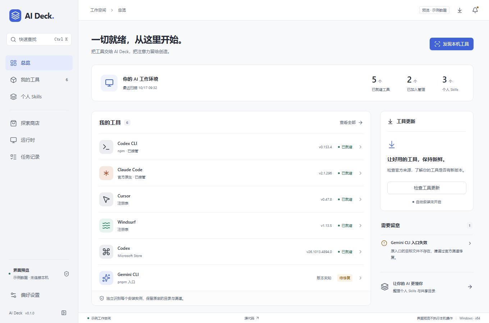

# AI Deck

个人 AI 工具管家：发现、安装和管理本机工具，按设置自动升级工具与个人 skills。

技术方案：Electron + React + TypeScript。

- [需求文档](docs/需求文档.md)：本机工具分类、MVP 范围与验收标准。
- [技术实现方案](docs/技术实现方案.md)：架构分层、执行内核、扩展方式与代码质量要求。

当前为 **v0.1.0 开发基础版**：已经有可运行的 Windows 客户端、七个工作区与真实只读发现。完整 MVP 尚未完成；安装/升级适配器与正式签名更新仍在后续范围内。



## 本地启动

已验证环境为 Windows 11 x64、Node.js 22.23.1、pnpm 11.10.0。Electron 自带 Node 24.22.0，不需要切换本机 nvm。

```powershell
pnpm install --frozen-lockfile
pnpm dev
```

在客户端点击“发现本机工具”执行只读扫描。已有工具、账号配置、全局 PATH 和 nvm 活动链接不会被修改。

仅检查界面：

```powershell
pnpm dev:web
```

浏览器打开 `http://127.0.0.1:5173`。网页会明确显示“预览 · 示例数据”；扫描、备份、恢复等本机操作只在桌面客户端可用。

## 当前功能

- 总览、工具、Skills、商店、运行时、任务记录、设置；浅色/深色/跟随系统、键盘快速搜索、实例详情侧栏。
- 注册表、Store、npm 安装、已知原生入口、pnpm 残留入口、nvm 和用户 Skills 的只读发现。
- npm 官方源版本检查、实例接管/取消接管、真实目录和运行时关联、受限官方入口。
- Skills 共享物理目标去重、完整树指纹、备份与恢复，检测扫描后的修改，保留恢复前的文件。
- SQLite 持久化、独立 utility worker、托盘、手动退出、后台版本检查和任务中断记录。

商店当前提供官方引导，**不执行安装**；工具自动安装开关明确禁用。未知 Skill 来源不被自动接管或覆盖。客户端更新状态机和协调代码已实现，但发布渠道验证开关保持关闭，等待签名与旧版升级验收。

## 验证与打包

```powershell
pnpm typecheck
pnpm check
pnpm test
pnpm exec playwright install chromium --only-shell
pnpm test:ui
pnpm build
pnpm test:electron
pnpm run pack
node scripts/electron-smoke.mjs --packaged
```

`pnpm run pack` 生成 `release/win-unpacked/AI Deck.exe` 及其依赖目录；请保留整个目录。注意 `pnpm pack` 是包管理器内置的 npm 压缩包命令，需要使用 `pnpm run pack`。

当前本地产物未签名，不是正式发行包。`pnpm run dist` 是 NSIS 打包入口，发布前仍需证书、发行元数据和真实旧版升级验收；普通退出不会自动安装客户端更新。

默认数据目录：`%LOCALAPPDATA%\AI Deck`。开发烟雾测试使用临时独立目录，不操作日常工具安装。Skill 文件操作测试仅使用临时夹具。

## 代码与文档

`src/main` 管理桌面生命周期；`src/preload` 暴露受限业务 API；`src/worker` 执行任务并持有 SQLite；`src/core` 保留纯策略；`src/adapters` 实现系统与存储边界；`src/renderer` 为 React 界面。

- [首轮开发与验收报告](docs/首轮开发与验收报告.md)
- [设计规范](DESIGN.md)
