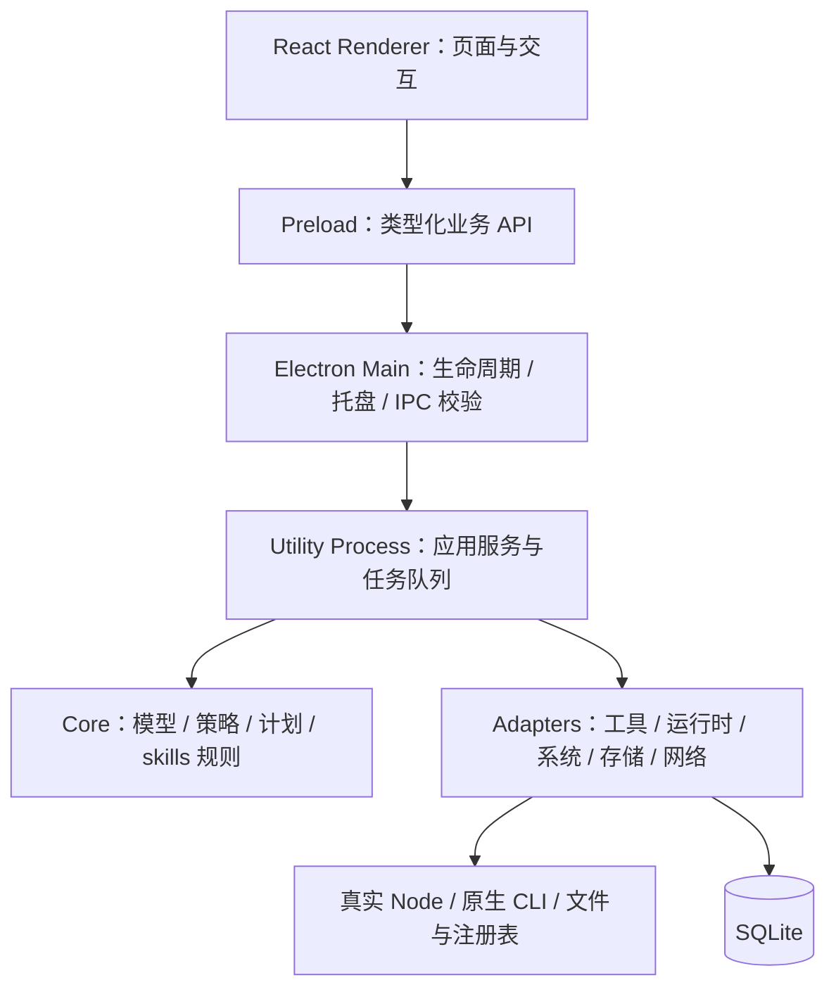

# AI Deck 技术实现方案

> 版本：MVP v1 · 日期：2026-10-17 · 技术基线：Electron + React + TypeScript · 依赖版本已于当日在线核实
>
> 产品范围见[需求文档](./需求文档.md)。本方案保留 MVP 目标架构；当前已完成 v0.1.0 可运行基础版，具体实现、验证证据和剩余范围见[首轮开发与验收报告](./首轮开发与验收报告.md)。性能基准和正式签名更新仍未验收。

## 1. 总体原则与技术组合

采用**单仓库、单桌面应用、一个持久任务进程**。业务规则与 Electron、操作系统和第三方工具实现分离，通过少量接口连接；新增工具主要新增适配器与商店条目。

| 用途 | 方案 |
| --- | --- |
| 桌面与界面 | Electron 44.9.0、React / React DOM 19.3.1、TypeScript 7.0.2 strict |
| 构建 | electron-vite 构建 main/preload/renderer；worker 配置独立 Node 构建入口并随包发布 |
| 本地存储 | SQLite，使用 better-sqlite3 13.0.3 的 Node-API 预编译模块；验收 worker 与发行包加载 |
| 安装包与自身更新 | electron-builder 26.17.0、electron-updater 6.8.10；Windows x64 用户级 NSIS 安装包 |
| 验证 | TypeScript 类型检查、Biome 2.5.15 检查/格式化、Vitest 5.0.5、关键 Electron/Windows 场景验证 |

初期不引入微服务、远程后端、通用插件引擎、复杂 DI 容器或多包仓库；确有独立边界和复用需求时再拆分。

### 具体版本基线

以下为 **2026-10-17 官方发布源的正式版本快照**，不采用 alpha、beta、rc、canary。直接依赖写精确版本，提交 `pnpm-lock.yaml`，CI 使用 frozen lockfile；后续更新通过验证后刷新版本表和锁文件，不在用户启动客户端时临时安装最新依赖。

| 组件 | 采用版本 | 用途与来源 |
| --- | --- | --- |
| Node.js，开发/CI | **26.12.0** | 最新 Current 正式版；最新 LTS 为 **24.22.0**，作为兼容验证环境。[官方版本索引](https://nodejs.org/dist/index.json) |
| pnpm | **12.14.0** | 项目包管理器，固定 `packageManager`。[发布元数据](https://registry.npmjs.org/pnpm/latest) |
| Electron | **44.9.0** | 自带 Node **24.22.0**、Chromium **152.0.7977.167**；与开发机 Node 分开。[官方发行索引](https://releases.electronjs.org/releases.json) |
| React / React DOM | **19.3.1 / 19.3.1** | 保持两个包版本一致。[React](https://registry.npmjs.org/react/latest)、[React DOM](https://registry.npmjs.org/react-dom/latest) |
| TypeScript | **7.0.2** | strict 类型检查。[发布元数据](https://registry.npmjs.org/typescript/latest) |
| electron-vite / Vite | **6.0.0 / 8.3.4** | 主进程、preload、renderer 构建；worker 配置独立入口。[electron-vite](https://registry.npmjs.org/electron-vite/latest)、[Vite](https://registry.npmjs.org/vite/latest) |
| @vitejs/plugin-react | **6.1.2** | React 构建插件，其 Vite 约束为 `^8.0.0`。[发布元数据](https://registry.npmjs.org/@vitejs%2Fplugin-react/latest) |
| electron-builder | **26.17.0** | 官方已发布的最新非预发布版本，使用 v26 正式线。[正式发行](https://github.com/electron-userland/electron-builder/releases/tag/electron-builder%4026.17.0) |
| electron-updater | **6.8.10** | 与上述 builder 同一正式发行配套。[版本源码](https://github.com/electron-userland/electron-builder/blob/electron-builder%4026.17.0/packages/electron-updater/package.json) |
| better-sqlite3 | **13.0.3** | SQLite 绑定；数据库引擎随包分发，验收时记录 `sqlite_version()`。[发布元数据](https://registry.npmjs.org/better-sqlite3/latest) |
| @electron/rebuild | **4.2.1，按需** | 后续引入需要重编译的原生依赖时使用；当前 SQLite 预编译路径不主动执行 rebuild。[发布元数据](https://registry.npmjs.org/@electron%2Frebuild/latest) |
| Vitest | **5.0.5** | 核心与适配器测试。[发布元数据](https://registry.npmjs.org/vitest/latest) |
| @biomejs/biome | **2.5.15** | 统一 JS/TS/React 静态检查与格式化。[发布元数据](https://registry.npmjs.org/@biomejs%2Fbiome/latest) |
| @types/react / @types/react-dom | **19.3.0 / 19.3.0** | React 19 类型定义。[React 类型](https://registry.npmjs.org/@types%2Freact/latest)、[DOM 类型](https://registry.npmjs.org/@types%2Freact-dom/latest) |
| @types/node | **24.19.2** | 匹配 Electron 内置 Node 24 的最新 24.x 类型；全局最新为 26.6.5，但不能据此对 main/worker 使用 Node 26 独有 API。[版本元数据](https://registry.npmjs.org/@types%2Fnode/24.19.2) |
| @types/better-sqlite3 | **9.6.0** | 所选 SQLite 包未自带声明，strict 检查需要单独类型包；类型包主版本不等于绑定主版本，实际使用接口须经类型检查和运行验证。[版本元数据](https://registry.npmjs.org/@types%2Fbetter-sqlite3/9.6.0) |

版本选择说明：builder/updater 的 npm 默认 `latest` 标签当日仍是 26.15.3/6.8.9，而正式 `v26` 标签及官方 release 已到 26.17.0/6.8.10，因此采用后者。类型包按实际运行时匹配。上述“最新”只针对该核实日期，实际初始化前重新核实并更新整组版本。

### 兼容性审查与落地约束

**结论：所选直接依赖未发现必须降级才能解决的版本范围冲突；全用最新版本不代表可以沿用旧配置。** 以下结论来自精确版本的官方 npm 元数据、发布包静态检查和官方运行规则；尚未生成锁文件或执行整套安装、构建和升级演练。

| 检查项 | 发现与处理 |
| --- | --- |
| React 与类型 | React DOM 19.3.1 要求 React `^19.3.1`；DOM 类型 19.3.0 要求 React 类型 `^19.3.0`，当前组合满足 |
| Vite 构建链 | electron-vite 6 接受 Vite 6/7/8；React 插件 6 要求 Vite `^8.0.0`；Vitest 5 接受 `^6.4.0 / ^7 / ^8`，Vite 8.3.4 满足。Vite 与 electron-vite 的 Rolldown 依赖范围存在交集，不额外强制覆盖其版本 |
| 开发与应用运行时 | Node 26 满足所选构建工具 engines，但 main/worker 实际运行在 Electron 内置 Node 24。构建目标设为 `node24`，类型使用 Node 24；渲染器目标为 `chrome152`。转译不能补齐 Node 26 新 API |
| TypeScript 7 | 发布包主入口不再提供旧式完整编译器 API；不能仅凭 peer 范围认定旧 TS 插件可用。通过 `tsc --noEmit` 独立检查，Vite 负责转译；不添加依赖旧编译器 API 的插件，不启用未经验证的 Vitest 内置类型检查 |
| 静态检查 | `typescript-eslint` 8.71.2 要求 TypeScript `>=4.8.4 <6.1.0`，与 TS 7 存在明确冲突，因此保留 Biome。Biome 不能代替 TypeScript 类型检查 |
| 沙箱 preload | Electron 沙箱 preload 不支持 ESM imports，且不能加载任意外部 npm 模块。必须输出单文件 CJS，将桥接辅助代码打入包；不生成共享 chunk 或遗留动态 import；不为兼容 ESM 关闭沙箱 |
| SQLite 原生模块 | better-sqlite3 13.0.3 使用 Node-API 10，官方包已包含 `prebuilds/win32-x64.node`，没有 install 脚本，且设置 `gypfile: false`。不能套用旧版 V8 ABI 重编译方案；保留预编译文件、解包到 ASAR 外，并在实际 utility process 验证加载 |
| pnpm 12 | 旧的 `onlyBuiltDependencies` 等设置已移除。使用 `allowBuilds` 显式允许 Electron 安装脚本，严格处理未审查脚本；保留 TypeScript/Biome/Rolldown 所需的平台 optional dependencies |
| builder 与 updater | 26.17.0 / 6.8.10 使用相同的 builder-util-runtime 9.7.0，未发现配套版本冲突。Windows 自更新只采用本方案的 NSIS 渠道，不能拿 portable 安装包复用相同验收结论 |

**构建与打包统一约定：**

- 构建配置使用 ESM；main 和 worker 显式输出 `.cjs`，preload 输出单文件 `.cjs`，renderer 由 Vite 构建。各进程使用独立 tsconfig；renderer 不注入 Node 全局类型，Electron 类型只用于所需边界。
- electron-vite 6 使用 `build.externalizeDeps` 和 Vite 8 的 `build.rolldownOptions`，不照抄旧版 `externalizeDepsPlugin()` 模板。preload 关闭依赖自动外置，Electron 与沙箱允许的内置模块保持外置；业务校验放 main/worker。
- `electron-updater`、`better-sqlite3` 放生产 dependencies；构建器、类型与测试工具放 devDependencies。main/worker 将 SQLite 保持外置，发行包显式包含其 JS 和目标平台 `.node` 文件，并配置 `asarUnpack`。
- 当前只有上述 Node-API SQLite 原生模块时，builder 设 `npmRebuild: false`，不添加无条件 `install-app-deps` 或 rebuild 钩子。新增其他原生依赖时重新评估，不能沿用此开关直接发布。
- 单应用先使用 pnpm 的 `nodeLinker: hoisted` 降低打包时符号链接布局的差异；它是打包基线选择，不代表 pnpm 默认布局与 builder 必然冲突。以下配置放在 `pnpm-workspace.yaml`，不需要因此拆成多包仓库：

```yaml
nodeLinker: hoisted
strictPeerDependencies: true
strictDepBuilds: true
allowBuilds:
  electron: true
```

发布前必须通过四个关口：① frozen-lockfile 安装无 engine/peer/脚本审批错误；② TS 7 类型检查、Biome、Vitest 和四个构建入口通过；③ Windows x64 已打包应用中，沙箱桥接可用、worker 能打开/迁移/写入 SQLite，记录 `process.versions.napi` 并确认至少为 10；④ 已安装旧版经签名 NSIS 更新成功、只重启一次且数据保留。开发 Node 下的 Vitest 通过不能替代第③④项。

## 2. 架构与进程分工



| 边界 | 负责 | 约束 |
| --- | --- | --- |
| Renderer | 总览、工具、Skills、商店、运行时、任务、设置 | 不直接访问文件、数据库、shell 或 Electron 高权限 API |
| Preload | 最小 `contextBridge`、DTO 与事件 | 每项业务单独暴露方法，不透传任意 IPC |
| Main | 单实例、窗口、托盘、通知、自启、IPC 身份验证、worker 生命周期、自身更新 | 不承载扫描、安装和同步数据库等耗时业务 |
| Worker | 组装依赖，调用用例，持有数据库和队列，执行后台任务 | 独立于窗口存在；崩溃重启后先核实任务再恢复 |
| Core | 领域模型、策略、计划、任务状态、冲突规则 | 不导入 Electron、SQLite、文件系统、HTTP 或具体适配器 |
| Adapters | 将核心接口落到具体工具、运行时、系统和持久化 | 不向核心泄漏第三方返回格式；新增工具不改 UI 分支 |

Core 定义所需端口，适配器实现端口，worker 显式组装。IPC DTO 与内部模型在入口转换，核心不依赖传输协议。utility process 用于工作与故障隔离，不能当作执行不可信代码的安全沙箱。

## 3. 目录与模块

```text
src/
  main/                 # app、tray、ipc、worker-host
    self-update/        # updater、状态、日志映射、更新退出协调
  preload/              # 受限业务桥
  renderer/
    features/           # overview、tools、skills、store、runtimes、tasks、settings、app-update
    components/         # 已有真实复用的基础组件
  shared/contracts/     # IPC DTO、运行时校验、错误码；无业务 I/O
  worker/               # 入口、依赖组装、请求到用例的映射
  core/
    models.ts           # 产品、安装实例、运行时、策略、计划、任务
    ports.ts            # 核心所需的少量接口
    inventory.ts        # 发现、证据合并、实例识别
    updates.ts          # 候选版本、策略、安装/升级计划
    skills.ts           # 来源、基线、链接和冲突
    jobs.ts             # 调度、状态流转与恢复规则
  adapters/
    tools/              # codex-npm、claude-native、gemini-npm、user-skill
    runtimes/           # nvm-windows
    system/             # process、files、windows-discovery、http
    persistence/        # sqlite、migrations
    catalog/            # 内置精选工具清单
tests/                  # 核心、适配器契约、关键集成场景
```

按实际复杂度拆文件，不预建大量空目录和抽象基类。UI 按功能组织，用例保持单一职责；工具特例留在对应适配器。初期使用明确的对象组合和函数参数传递依赖。

## 4. 核心模型与扩展方式

| 模型 | 必要信息 |
| --- | --- |
| ToolDefinition | 产品 ID、分类、官方来源、适配器 ID、平台及能力 |
| Installation | 实例 ID、产品、安装来源、逻辑/真实路径、原始/规范化版本、状态、运行时、prefix |
| Runtime | 提供者、真实 Node/npm 路径、版本、架构、健康状态、当前活动关系 |
| SkillBinding | 来源、commit/来源指纹、宿主、作用域、逻辑/物理目录、完整树基线 |
| UpdatePolicy | 总/实例开关、检查模式、安装时段、时区、通道、固定版本、更新执行者 |
| Job / RecoveryPoint | 目标实例、计划、步骤、状态、资源身份、进程身份、错误与恢复范围 |

产品定义随应用发布；安装、运行时、skills、策略、任务和恢复点存 SQLite。仅 worker 持有数据库连接，使用有版本的 SQL 迁移；数据库事务只覆盖状态写入，不能包住外部安装器并假定软件更新可以回滚。

### 工具适配器

统一协议覆盖 `discover → inspect → checkUpdate → plan → execute → verify`，恢复作为显式可选能力。

- `plan` 生成明确的安装或更新计划：实例、版本、真实写入路径、运行时、权限、来源、阻塞条件与恢复范围。
- `execute` 只能执行已经保存并复核的计划，进程、下载、文件写入通过受控端口完成。
- 能力分别声明安装、自动更新、固定版本、恢复；不支持的能力返回明确原因。
- npm 类适配器可复用经过验证的执行函数；不建立包含所有产品特例的万能父类或脚本 DSL。
- UI 根据能力展示操作，不使用 `if toolName === ...` 编排安装逻辑。

新增工具的步骤：新增定义 → 复用或实现适配器 → 添加契约/集成用例 → 验收对应渠道 → 开启能力。适配器静态注册；商店数据不携带任意命令或远程可执行代码。

## 5. nvm 与执行内核

本机 `D:\tools\node` 是 nvm 活动链接，用户 npm prefix/cache 又位于该链接下。已验证用 Node 14/22/24 的真实文件查询 prefix，仍返回同一逻辑路径；执行时必须显式固定写入目标。

每个受管 npm 实例保存四项绑定：**真实 `node.exe`、对应 npm JS 入口、真实 prefix、子进程环境策略**。

1. 发现 nvm 版本目录并检查文件与实际版本；只有目录存在不算健康运行时。
2. 已有工具沿用真实目录；新装工具可用 `%LOCALAPPDATA%\AI Deck\tools\<tool-id>\npm-prefix`，选择满足该工具要求的已安装 Node。
3. 使用绝对 Node 调用对应 npm CLI，参数数组显式传入 `--prefix` 等写入范围；构造子进程 PATH，让 npm 脚本内的 `node` 也命中绑定版本。
4. 处理继承的 npm 配置与缓存路径，保留所需 registry/代理兼容性；不修改全局 `.npmrc`、用户环境变量或执行 `nvm use`。
5. 执行前复核真实目标和权限。活动链接变化时，不将计划重定向到新目标；目标消失或身份变化则暂停。
6. 受管稳定 launcher 调用绑定的 Node/CLI。首次启用时明确默认命令和 PATH 变更；原生 CLI 保持原生渠道。

Electron 自带 Node 运行客户端 main/worker；工具使用其绑定的外部运行时。不得在 AI Deck 进程中导入第三方 CLI，或依赖 Electron 可执行文件冒充系统 Node。

运行时兼容性使用所选工具版本的要求检查。Node 被删除或新工具要求更高版本时，保留可用状态并提供重新绑定方案；首版不自动升级所有 Node 或复制全部全局包。

## 6. 调度、任务与恢复

```text
候选更新 → 等待策略/时段 → 预检 → 执行 → 验证 → 成功
                         ↘ 延后 / 需要处理 / 失败 / 恢复中 / 已恢复
```

- 一个应用实例、一个持久队列；首版变更任务串行，元数据查询有限并发。同一实例或共享物理目标不重复创建更新任务。
- 调度只负责触发用例；时间通过可替换时钟读取。每日任务保存时区，持续检查默认 30 分钟，唤醒/联网事件合并补查。
- 执行前写入计划和步骤日志；保存外部进程 PID、启动时间、程序路径等身份信息，不能仅凭 PID 判断安装仍在运行。
- worker 崩溃、超时或重启后，先核实外部进程和真实版本，再决定等待、验证、恢复或失败。取消只能在安全边界执行，不能承诺取消会撤销安装。
- 被占用时延后，不杀用户进程；不能恢复的渠道直接记录限制。退出码、实际版本和目标路径共同决定成功。
- 网络错误保留上次结果与时间，按错误类别有限退避；来源/权限/本地冲突不无限重试。

**Skills：** 固定上游来源与 commit，限制下载规模和路径；生成完整树指纹，比较管理基线；有本地修改时停止覆盖。共享 junction 解析后只更新一次，系统与插件缓存保持宿主所有权。首次来源/基线未知时保留当前目录并展示差异。

Skills 替换使用同卷暂存、备份、重命名和步骤日志；多个目录不假定具有跨文件系统原子性。恢复前检查目标是否又被用户修改，保留无法自动处理的副本。npm 可记录旧版本并按条件重装，但不承诺完整原子回滚或用户配置恢复。

## 7. IPC、存储与安全边界

- renderer 开启 `contextIsolation` 与 sandbox，关闭 `nodeIntegration`；preload 只暴露业务方法。
- main 验证 IPC 来源和运行时 schema。UI 只提交实例 ID、策略或计划 ID；执行计划由 worker 生成，不能接受 UI 传入的任意路径与命令。
- 系统探测使用固定实现；程序采用绝对路径和参数数组，避免 shell 拼接。不可避免的 Windows 脚本使用固定模板并验证参数。
- 来源使用明确的官方包名、仓库与允许域；按渠道校验签名/可信完整性信息。HTTPS 或自行计算的哈希不能单独证明发布者身份。
- 远程文本作为数据渲染，不作为本地权限页面或执行策略。npm 生命周期脚本按具体官方包审查，不能将包名允许列表视为完全隔离。
- 数据置于 `%LOCALAPPDATA%\AI Deck`，分别保存 `state.db`、`logs`、`cache`、`backups`；限制缓存和备份保留量，保留未处理失败所需恢复点。
- 不读取或上传账号密钥，日志对命令参数、URL 和外部输出脱敏；软件配置和登录仍由原工具管理。

AI Deck 自身更新由 main 的独立模块负责，按安装包渠道验证签名与版本；第三方软件更新由工具适配器负责，两者使用独立设置和任务链路。具体实现如下。

## 8. 客户端自身一键升级

### 交互与状态

正常路径：**后台检查 → 下载并校验 → 升级图标就绪 → 悬停查看日志 → 点击一次 → 安装并自动重启 → 返回原页面。** 用户无需找安装包、选目录或再次确认启动。

| 状态 | 界面与操作 |
| --- | --- |
| 无更新 / 检查中 | 保持安静；设置页提供手动检查 |
| 发现更新 / 下载中 | 固定位置显示升级图标和进度，悬停显示目标版本与日志；安装操作待资源就绪后启用 |
| 下载校验完成 | 图标高亮，提示“更新至 vX.Y.Z 并重启”；点击立即进入更新流程 |
| 等待当前任务 | 显示“当前任务完成后自动重启更新”；暂停新变更任务，用户无需再次点击 |
| 安装与重启 | 禁止重复提交，显示重启状态；自动重新打开客户端并显示本次升级结果 |
| 下载/校验失败 | 保持当前客户端可用；图标显示失败原因与重试入口，不显示“已可安装” |

日志使用可悬停、聚焦和滚动的轻量 popover，展示目标版本、发布日期及新增/改进/修复/兼容性说明；跨版本升级按版本归并记录。图标具备可读标签，键盘聚焦同样可查看日志；说明缺失时显示明确提示。日志只渲染安全文本，不执行远程 HTML。

### 实现职责与更新调用

- main 的 `self-update` 模块独立维护 `checking/downloading/ready/waiting/installing/failed` 状态，只向 UI 发送精简状态、日志和进度。
- 默认启动后检查、每 6 小时检查，并缓存去重；自动下载，**安装由用户点击触发**，与第三方工具自动升级总开关独立。设置可暂停后台检查/下载。
- 使用 `electron-updater` 的 `update-available`、`download-progress`、`update-downloaded`、`error` 事件；GitHub provider 配置 `fullChangelog = true` 获取跨版本说明。
- `autoDownload = true`、`autoInstallOnAppQuit = false`、`allowPrerelease = false`、`allowDowngrade = false`。普通退出不偷偷安装，不使用预发布版或自动降级。
- 点击只发送“安装已下载更新”的业务请求；main 验证状态与目标版本，确认资源已经校验后执行。不得由 renderer 指定下载 URL、安装路径或 shell 命令。

已按配套 v26 源码核实的最终调用为 `autoUpdater.quitAndInstall(true, true)`：请求静默安装并在完成后重新运行。调用前执行以下协调：

1. 暂停创建新的安装/升级任务；当前有外部安装任务时等待其完成，不强制结束用户工具。
2. 保存窗口位置、当前页面及任务状态；worker 提交数据库写入并关闭连接，退出后不被主进程自动拉起。
3. 设置更新退出标记，使关闭窗口与退出事件绕过“隐藏到托盘”逻辑，然后调用安装接口；不额外调用 `app.relaunch()` 造成重复重启。
4. 新版本启动后核实版本和待恢复任务，再恢复调度与页面；数据库迁移使用事务和迁移前备份，失败时保留原数据并提供恢复提示。

接口依据为[所选 v26 正式发行源码](https://github.com/electron-userland/electron-builder/blob/electron-builder%4026.17.0/packages/electron-updater/src/BaseUpdater.ts)，不照搬新版文档中可能尚未适用于本版本的调用形式。

### 安装包与发布闭环

- Windows 首版使用 **NSIS 当前用户安装**：`oneClick: true`、`perMachine: false`、`runAfterFinish: true`，保持 appId、安装位置和签名发布者身份稳定；正常升级不要求重新选择目录。
- 更新源采用项目正式 GitHub Releases，按平台/架构提供 NSIS 安装包、`latest.yml` 和对应 blockmap；安装包、元数据和日志齐备后再公开 release，不发布不完整更新。
- Windows 发布包使用可信 Authenticode 签名，配置并保留发布者验证；下载按元数据校验 SHA-512。关闭签名校验不能作为正常发布方案。签名凭证放 CI 安全存储，不进入客户端或仓库。
- 每次正式 release 必须提供面向用户的更新日志：新增、改进、修复、必要兼容性说明；不暴露提交噪音和内部实现细节。
- 应用版本以 `package.json.version` 为唯一来源，与 Git tag、release 和更新元数据一致；已经公开的版本及安装包保持不可变。更新日志维护在 GitHub Release 内容中，不另增一份重复的设计文档。
- 发布流水线固定版本构建 → 检查/测试 → 打包签名 → 隔离环境旧版到新版升级演练 → 完整发布。自动更新通路使用已安装旧版验证，开发模式模拟不能代替验收。

“一键”以普通用户安装和正常权限为基础；不支持的发行渠道、管理员权限限制或安装器故障必须给出真实结果。下载失败不退出客户端；安装中失败记录日志并在可启动时提供恢复入口，不承诺任意版本自动回滚。

验收覆盖：悬停/键盘查看日志、跨版本日志、下载失败与签名失败、点击一次后静默安装并只重启一次、关闭到托盘不拦截更新、有运行任务时自动等待、重启后设置/数据库/页面保留、普通退出不安装。

## 9. 代码质量与维护规则

| 方面 | 实施约束 |
| --- | --- |
| 类型与契约 | strict；外部输入按 `unknown` 校验；禁止靠广泛 `any` 绕过边界；DTO 不泄漏 Electron 对象 |
| 依赖方向 | UI 只通过 bridge；core 只依赖自身模型和端口；适配器实现端口；CI 检查越层导入 |
| 错误处理 | 统一错误码、可重试性和用户操作建议；保留原始原因供脱敏诊断；不空 catch 或伪造成功 |
| 简洁性 | 函数职责明确；优先直接组合；共享抽象在真实复用出现后提取；不引入未使用的配置和扩展点 |
| 测试 | 核心测试策略/状态流转；适配器测试真实边界；集成测试在隔离 Windows 环境执行，不更新开发者日常工具 |
| 发布 | 精确版本及锁文件；TypeScript/Biome/测试/构建通过；验收 worker 入口、原生模块、SQLite、签名与旧版一键升级 |
| 可诊断性 | 结构化日志包含任务/实例 ID、步骤与耗时；UI 显示可处理原因；禁止记录凭证 |

关键测试必须覆盖：nvm 切换和 prefix 配置、脚本中的 Node 解析、多副本、失效入口、工具占用、skills 本地修改/junction、网络失败、worker 崩溃、外部安装器仍存活、备份恢复。UI 只测关键用户流程，不为简单展示编写大量镜像实现的测试。

## 10. 实现顺序

1. **骨架验证**：按版本表初始化；安全 IPC、托盘/退出、单实例、worker、SQLite 发行包；尽早完成最小旧版到新版的一键升级演练，测量启动、空闲资源和 UI 响应。
2. **只读发现**：注册表/Appx/已知目录、nvm 健康识别、多实例及 skills 来源与差异。
3. **首个完整适配器**：Codex npm 在隔离环境完成计划、升级、验证和故障恢复；验收 nvm 切换与稳定入口。
4. **工具与 skills 扩展**：Claude 原生、Gemini 安装/修复、skills 来源接管与备份恢复。
5. **产品闭环**：精选商店、自动策略、通知、任务诊断、悬停更新日志与自身升级完整验收。

每阶段完成可运行纵向流程后再扩展，不先铺设大量空壳模块。MVP 不追求覆盖所有安装渠道，新增能力必须有对应的安装、升级和失败处理验收记录。

## 11. 主要技术依据

- [Electron 进程模型](https://www.electronjs.org/docs/latest/tutorial/process-model)、[utilityProcess](https://www.electronjs.org/docs/latest/api/utility-process)、[安全指南](https://www.electronjs.org/docs/latest/tutorial/security)。
- [electron-vite](https://electron-vite.org/guide/)、[electron-builder / electron-updater](https://github.com/electron-userland/electron-builder)、[原生模块与 Electron ABI](https://www.electronjs.org/docs/latest/tutorial/using-native-node-modules)。
- [nvm-windows](https://github.com/coreybutler/nvm-windows)、[npm prefix 与目录规则](https://docs.npmjs.com/cli/v11/configuring-npm/folders)。
- [electron-builder 自动更新](https://www.electron.build/docs/features/auto-update)、[NSIS 配置](https://www.electron.build/docs/nsis)、[所选版本更新器实现](https://github.com/electron-userland/electron-builder/tree/electron-builder%4026.17.0/packages/electron-updater/src)、[Biome](https://biomejs.dev/)。版本号以本文件中的官方 npm/Node/Electron 元数据为准，在线文档可能默认展示后续主版本。
- 兼容性依据：[Electron ESM 与沙箱 preload 限制](https://www.electronjs.org/docs/latest/tutorial/esm)、[electron-vite 依赖处理](https://electron-vite.org/guide/dependency-handling)、[pnpm 12 构建脚本设置](https://pnpm.io/settings/build)、[Node-API 版本矩阵](https://nodejs.org/api/n-api.html#node-api-version-matrix)。
- 关键精确版本：[TypeScript 7.0.2](https://registry.npmjs.org/typescript/7.0.2)、[better-sqlite3 13.0.3](https://registry.npmjs.org/better-sqlite3/13.0.3)、[typescript-eslint 8.71.2](https://registry.npmjs.org/typescript-eslint/8.71.2)；原生预编译文件及编译器入口按元数据中 `dist.tarball` 对应的官方发布包检查。

方案尚需通过隔离环境中的安装器、更新、恢复和性能验证，不能把设计能力标记为已经实现。
